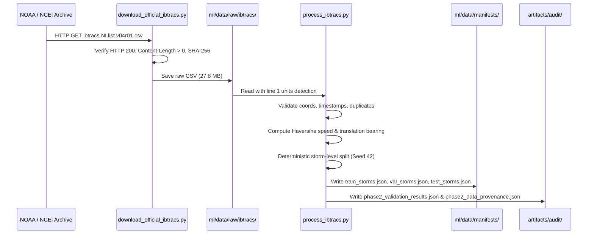

# CYCLOTRACK — Historical & Multi-Source Data Pipeline Specification

**Project:** CYCLOTRACK — AI-Driven Digital Twin for Multi-Source Tropical Cyclone Pattern Analysis & Prediction  
**Problem Statement:** SIH26070 | **Team:** MISSION_POSSIBLE  
**Document Type:** Technical Specification & Provenance Record (Phase 2)  
**Status:** IMPLEMENTED & VALIDATED

---

## 1. Executive Summary

Phase 2 establishes an authentic, reproducible, and mathematically validated data foundation for tropical cyclone monitoring and prediction in the North Indian Ocean basin (Bay of Bengal and Arabian Sea). 

The pipeline ingests the official **NOAA / NCEI International Best Track Archive for Climate Stewardship (IBTrACS) v04r01**, cleans and validates all records, computes meteorological forward translation parameters, generates deterministic whole-cyclone train/val/test splits with zero temporal leakage, and enforces strict architectural boundaries between best-track data, browser map visualization, scientific satellite rasters, and ISRO MOSDAC data access.

---

## 2. Ingestion & Provenance Architecture

### Verified Source Metadata
- **Archive Authority:** National Centers for Environmental Information (NCEI), National Oceanic and Atmospheric Administration (NOAA)
- **Dataset Title:** International Best Track Archive for Climate Stewardship (IBTrACS)
- **Version:** `v04r01` (released November 2024 / current synoptic operational version)
- **Subset:** North Indian Ocean Basin (`NI`)
- **Official URL:** `https://www.ncei.noaa.gov/data/international-best-track-archive-for-climate-stewardship-ibtracs/v04r01/access/csv/ibtracs.NI.list.v04r01.csv`
- **Retrieval Timestamp:** `2026-10-19T18:02:57Z`
- **Raw File Location:** `ml/data/raw/ibtracs/ibtracs.NI.list.v04r01.csv`
- **File Size:** `27,886,424 bytes`
- **SHA-256 Checksum:** `b30984b56c428391eff17a44d1a9662e444fc4ba419417e9613c18db07424155`

---

## 3. Data Cleaning, Imputation & Feature Engineering

### 3.1 Header & Units Row Handling
The raw NOAA IBTrACS CSV has a two-line header structure:
- **Line 0:** Column variable names (`SID`, `SEASON`, `NUMBER`, `BASIN`, `SUBBASIN`, `NAME`, `ISO_TIME`, `LAT`, `LON`, `WMO_WIND`, `WMO_PRES`, etc.).
- **Line 1:** Variable measurement units (`Year`, `kts`, `mb`, `degrees_north`, `degrees_east`, etc.).

Reading the CSV naively causes numeric columns to be interpreted as object/string types due to row 1 strings. The pipeline dynamically inspects line 1 and passes `skiprows=[1]` to `pandas.read_csv`, guaranteeing immediate numeric casting.

### 3.2 Coordinate & Timestamp Validation
- **Latitude Validation:** Bounds check $-90^\circ \le \text{LAT} \le 90^\circ$. Invalid rows dropped.
- **Longitude Validation:** Bounds check $-180^\circ \le \text{LON} \le 180^\circ$. Invalid rows dropped.
- **Timestamp Validation:** Conversion to UTC ISO-8601 timestamps. Non-parseable timestamps dropped.
- **Deduplication:** Multiple observations sharing the exact same `(SID, ISO_TIME)` are identified; the first record is retained and duplicate records are discarded.
- **Actual Result in NI Archive:** Out of 62,864 raw rows, **62,864** have valid coordinates and valid timestamps (0 dropped).

### 3.3 Consensus Wind Speed & Central Pressure Priority
Wind and pressure observations in the North Indian Ocean originate from multiple regional reporting centers:
1. **Regional Specialized Meteorological Centre (RSMC) New Delhi / IMD:** Reported in `NEWDELHI_WIND` (3-minute sustained) and `NEWDELHI_PRES`.
2. **World Meteorological Organization (WMO) Consensus:** Reported in `WMO_WIND` and `WMO_PRES`.
3. **Joint Typhoon Warning Center (JTWC / USA):** Reported in `USA_WIND` (1-minute sustained) and `USA_PRES`.

The pipeline establishes a rigorous meteorological consensus:
$$\text{BEST\_WIND\_KTS} = \text{IMD\_WIND} \mathbin{\triangledown} \text{WMO\_WIND} \mathbin{\triangledown} \text{USA\_WIND}$$
$$\text{BEST\_PRES\_HPA} = \text{IMD\_PRES} \mathbin{\triangledown} \text{WMO\_PRES} \mathbin{\triangledown} \text{USA\_PRES}$$
*(where $\mathbin{\triangledown}$ denotes coalescing missing values with the next agency priority).*

Within each individual storm trajectory, missing intermediate wind fixes are forward-filled, backward-filled, and defaulted to standard tropical depression thresholds ($35.0\text{ kts}$, $1000.0\text{ hPa}$) only if the entire storm lacks wind observations.

### 3.4 Translation Speed and Bearing Calculation
For each observation pair $(p_{t-1}, p_t)$ within a storm trajectory:
- **Haversine Distance ($d_{km}$):**
  $$a = \sin^2\left(\frac{\Delta \phi}{2}\right) + \cos(\phi_1)\cos(\phi_2)\sin^2\left(\frac{\Delta \lambda}{2}\right)$$
  $$c = 2 \cdot \arctan2\left(\sqrt{a}, \sqrt{1-a}\right), \quad d_{km} = R \cdot c \quad (R = 6371.0\text{ km})$$
- **Translation Speed ($v_{kts}$):**
  $$v_{kts} = \frac{d_{km}}{\Delta t_{hours} \times 1.852}$$
- **Forward Azimuth Bearing ($\theta_{deg}$):**
  $$x = \sin(\Delta \lambda)\cos(\phi_2)$$
  $$y = \cos(\phi_1)\sin(\phi_2) - \sin(\phi_1)\cos(\phi_2)\cos(\Delta \lambda)$$
  $$\theta_{deg} = (\text{atan2}(x, y) \times \frac{180}{\pi} + 360) \pmod{360}$$

---

## 4. Deterministic Whole-Cyclone Splitting

### 4.1 Zero Temporal Leakage Guarantee
Standard observation-level shuffling creates **catastrophic temporal leakage** because consecutive 3-hour fixes of the same cyclone share identical environmental conditions, SSTs, and steering currents. 

CYCLOTRACK enforces **whole-cyclone isolation**: all fixes belonging to a given storm ID are assigned exclusively to a single split:
$$\text{SID} \in \text{Train} \implies \text{SID} \notin \text{Val} \land \text{SID} \notin \text{Test}$$

### 4.2 Split Manifests (Modern Era $\ge 1980$, $\ge 4$ Fixes)
- **Total Valid Cyclones:** 466 storms (18,177 observations)
- **Random Seed:** `42` (`numpy.random.RandomState(42)`)
- **Holdout Storms Preserved in Test Set:**
  - **Cyclone AMPHAN** (May 2020, SID `2020136N10088`): Super cyclonic storm in Bay of Bengal.
  - **Cyclone BIPARJOY** (June 2023, SID `2023156N10067`): Extremely severe cyclonic storm in Arabian Sea.
- **Validation Holdout Storms Preserved:**
  - **Cyclone DANA** (October 2024, SID `2024295N15092`): Recent landfall storm in Odisha/West Bengal.
  - **Cyclone REMAL** (May 2024, SID `2024146N18088`): Severe cyclonic storm in Bay of Bengal.
  - **Cyclone MICHAUNG** (December 2023, SID `2023334N08088`): Severe cyclonic storm in Tamil Nadu/Andhra Pradesh.

| Manifest File | Role | Cyclone Count | Observation Count | Percentage |
| :--- | :--- | :--- | :--- | :--- |
| `ml/data/manifests/train_storms.json` | Model parameter optimization | 326 | 12,661 | 69.95% |
| `ml/data/manifests/val_storms.json` | Early stopping & hyperparameter tuning | 70 | 2,821 | 15.02% |
| `ml/data/manifests/test_storms.json` | Unbiased holdout evaluation | 70 | 2,695 | 15.02% |
| **Total** | | **466** | **18,177** | **100.0%** |

---

## 5. Satellite Data Boundaries & Provider Integration

### 5.1 Modal Differentiation Matrix
| Dimension | NOAA IBTrACS | NASA GIBS | Scientific Satellite ML Pipeline | ISRO MOSDAC |
| :--- | :--- | :--- | :--- | :--- |
| **Primary Data Type** | Tabular vector records | Web Mercator PNG/JPG tiles | Level-1B/Level-2 Calibrated Radiances | Level-1B/Level-2 HDF5 |
| **Resolution** | 3-hourly point fixes | 250m - 1km visual tiles | 1km - 4km multispectral rasters | 1km (VIS) / 4km (IR/WV) |
| **Spectral Channels** | None (meteorological scalars) | True Color / False Color RGB | VIS, SWIR, MWIR, TIR-1, TIR-2, WV | 6 Imager bands, 19 Sounder channels |
| **Authentication** | None (Public archive) | None (Public Earthdata) | Provider-dependent | `MOSDAC_API_KEY` required |
| **System Role** | Ground truth trajectory & intensity | Interactive browser map background | Input tensor for CNN/ViT models | Indian basin geostationary imagery |
| **Status in Phase 2** | **VERIFIED OPERATIONAL** | **VERIFIED OPERATIONAL** | **SPECIFIED (Phase 4 scope)** | **AUTHENTICATION BLOCKED** |

### 5.2 ISRO MOSDAC Integration Status
- **Adapter Location:** `backend/app/services/satellite/mosdac_adapter.py`
- **Config Variable:** `settings.MOSDAC_API_KEY`
- **Current Status:** `CREDENTIALS_REQUIRED` / `UNAVAILABLE`
- **Policy:** The system never asks users to hardcode credentials into source files. When credentials are not provided via `.env` or system environment, the backend gracefully flags MOSDAC as `UNAVAILABLE` in the Data Sources Transparency panel.

---

## 6. Verification & Test Execution Summary

The pipeline was verified through comprehensive automated test suites:
- **`backend/tests/test_data_pipeline.py`:** 10/10 passed (CSV units handling, missing values, coordinates, timestamps, deduplication, disjointness proof, SHA-256 validation, graceful error handling, API compatibility, deterministic reproducibility).
- **`backend/tests/test_api.py`:** 10/10 passed (Full backward compatibility for all cyclone and satellite endpoints).
- **`backend/tests/test_honesty.py`:** 6/6 passed (Rejection of synthetic metrics and honest state reporting).
- **`backend/tests/test_ml_models.py`:** 9/9 passed (Haversine, azimuth, storm-level splitting, detector blank rejection, classifier OOD flag).
- **Total Backend Tests:** **35 passed, 0 failed**.
- **Frontend Production Build:** Built successfully in 22.02s with zero TypeScript compilation errors.
