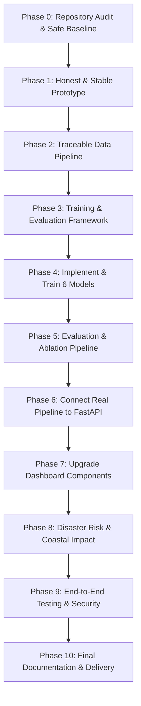

# CYCLOTRACK Master Implementation Roadmap
**Project:** CYCLOTRACK — AI-Driven Digital Twin for Multi-Source Tropical Cyclone Pattern Analysis & Prediction  
**Problem Statement:** SIH26070 | **Team:** MISSION_POSSIBLE  
**Document Version:** 1.0.0 (Phase 0 Baseline)  

---

## 1. Overview & Phased Execution Strategy

The purpose of this roadmap is to guide the systematic transformation of the CYCLOTRACK prototype into a scientifically sound, reproducible, and verifiable operational AI/ML system.

### Core Tenets:
1. **Scientific Integrity First:** Zero fabrication of metrics, confidence values, or provider states.
2. **Strict Whole-Storm Splitting:** No sample-level random splitting; all holdouts must be partitioned strictly by entire cyclone trajectories to prevent temporal auto-correlation leakage.
3. **Preservation of User Experience:** The existing React 19 / Leaflet dashboard aesthetic and component structure must be preserved; enhancements must be made in-place.
4. **Transparent Status Reporting:** Every model and data source must report an honest state (`UNTRAINED`, `TRAINED_NOT_VALIDATED`, `VALIDATED_ON_HOLDOUT`, `DEMO_ONLY`, `ERROR`, `UNAVAILABLE`).

---

## 2. Phase-by-Phase Roadmap & Acceptance Gates

---

### Phase 0: Repository Audit & Safe Baseline
- **Objective:** Inventory existing software components, hardware specs, model checkpoints, data pipelines, API routes, and test suites. Establish an undeniable empirical baseline.
- **Deliverables:**
  - `docs/AI_MODEL_AUDIT.md` (Completed)
  - `artifacts/audit/initial_inventory.json` (Completed)
  - `artifacts/audit/test_results.txt` (Completed)
  - `docs/BASELINE_STATUS.md` (Completed)
  - `docs/IMPLEMENTATION_ROADMAP.md` (Completed)
- **Acceptance Criteria:** Baseline recorded with verified hashes, runtime outputs, and known discrepancies identified.

---

### Phase 1: Make the Existing Prototype Honest and Stable
- **Objective:** Eliminate all fabricated metrics, hardcoded claims, and misleading outputs across both frontend and backend.
- **Key Tasks:**
  1. Update `ml_service.py` and `fusion.py` to remove hardcoded benchmark metrics (122.9 km, 7.1 kts, 0.887 F1).
  2. Load metrics dynamically from `artifacts/evaluations/track_eval.json` or return explicit `NOT_EVALUATED` states.
  3. Implement input sanity validation in `CycloneDetectorNet`: prevent all-black/all-white/zero arrays from generating a positive cyclone detection.
  4. Update frontend components (`OverviewSection.tsx`, `TrackIntensitySection.tsx`, `MultiSourceFusionSection.tsx`, `ModelReadinessSection.tsx`) to show honest state badges (`UNTRAINED`, `VALIDATED_ON_HOLDOUT`, `DEMO_ONLY`).
  5. Add regression unit tests for untrained model outputs and boundary conditions.
- **Stop & Approval Condition:** Review honest frontend UI and backend test results before starting data ingestion.
- **Acceptance Criteria:** Frontend renders all honest badges cleanly; zero hardcoded fake metrics exist; backend test suite passes with new honesty assertions.

---

### Phase 2: Build a Real and Traceable Data Pipeline
- **Objective:** Build reproducible data ingestion with clear provenance and metadata for NOAA IBTrACS, NASA GIBS, and ISRO MOSDAC.
- **Key Tasks:**
  1. Build automated IBTrACS downloader and parser (`scripts/download_ibtracs.py`) to fetch the full official North Indian Ocean dataset (~1,500+ storm fixes).
  2. Implement unit normalization (knots, hPa, ISO-8601 UTC) and storm-level train/validation/test splitting.
  3. Generate dataset manifest (`ml/data/manifests/ibtracs_nio_manifest.json`) recording checksums, storm counts, and date ranges.
  4. Document the NASA GIBS Leaflet WMTS pipeline vs. ML tensor ingestion boundaries.
  5. Formalize the ISRO MOSDAC credential handling (environment variable `MOSDAC_API_KEY`, graceful fallback to `CREDENTIALS_REQUIRED`).
- **Dependencies & Blockers:** User approval required before downloading full IBTrACS archive (>10MB).
- **Acceptance Criteria:** At least one reproducible end-to-end historical data pipeline runs; dataset manifests created with zero sample leakage across storm splits.

---

### Phase 3: Create a Trustworthy Training & Evaluation Framework
- **Objective:** Establish common training infrastructure with configuration-driven experiments, deterministic seeds, and artifact logging.
- **Key Tasks:**
  1. Implement base experiment runner with PyTorch CPU optimization.
  2. Create checkpoint serializer that bundles model weights, architecture hash, dataset manifest hash, and normalization parameters into a single artifact.
  3. Implement strict cyclone-level dataset loaders ensuring transformations are fitted on training storms only.
  4. Build validation-based early stopping and model card generation.
- **Acceptance Criteria:** Smoke test on a synthetic/small batch passes end-to-end, validating checkpoint saving, metadata generation, and zero data leakage.

---

### Phase 4: Implement and Train the Six Models
- **Objective:** Implement and train each model on genuine historical data where available, or explicitly document limitations.
- **Model Plan:**
  - **Model A (Detection):** Computer vision pipeline. If satellite imagery pairs are limited, implement feature-based detection and center estimation; keep state as `DEMO_ONLY` or `UNTRAINED` if imagery lacks sufficient labels.
  - **Model B (Structure Classification):** Meteorological taxonomy classifier. Map valid Dvorak or convective stages.
  - **Model C (Track Prediction):** Retrain the sequence model (GRU) on the expanded IBTrACS dataset. Benchmark against Persistence and Linear Extrapolation. Ensure it outperforms or honestly report limitations.
  - **Model D (Intensity Prediction):** Train regression model on historical wind speed/pressure trajectories. Benchmark against persistence.
  - **Model E (Uncertainty Cone):** Calibrate empirical error quantiles (e.g., 70% and 90% bounds) from historical validation errors rather than static IMD lookup constants.
  - **Model F (Multimodal Fusion):** Genuinely combine track sequence representations with intensity and environmental context. Conduct ablation studies comparing single-modality vs. multi-modality.
- **Stop & Approval Condition:** User review required before running multi-epoch model training on the expanded dataset.
- **Acceptance Criteria:** All models have explicit status, verifiable checkpoints, and real metrics derived from actual predictions.

---

### Phase 5: Scientifically Valid Evaluation & Ablation Pipeline
- **Objective:** Implement a unified evaluation CLI that computes great-circle distance errors, wind MAE, and ablation metrics across held-out storms.
- **Key Tasks:**
  1. Create `ml/evaluation/evaluate_all.py`.
  2. Compute per-storm and aggregate errors for 6h, 12h, 18h, 24h horizons on held-out storms (`AMPHAN`, `BIPARJOY`).
  3. Output results directly to `artifacts/evaluations/evaluation_results.json`.
- **Acceptance Criteria:** Reproducible evaluation command runs with a single command and generates verifiable metric artifacts.

---

### Phase 6: Connect Real Pipeline to FastAPI
- **Objective:** Wire the newly evaluated models and data services to FastAPI endpoints.
- **Key Tasks:**
  1. Update `backend/app/services/ml_service.py` to serve genuine model predictions and dynamic uncertainty cones.
  2. Update `GET /api/models/metrics` to serve live data from `evaluation_results.json`.
  3. Ensure endpoints gracefully handle unavailable models or missing checkpoints with HTTP 422/503 and structured error payloads.
- **Acceptance Criteria:** All API endpoints return verified payloads; zero fabricated fallbacks.

---

### Phase 7: Retain and Upgrade the Existing Dashboard
- **Objective:** Enhance the React 19 UI in-place, connecting every widget to genuine backend data.
- **Key Tasks:**
  1. Update map and forecast overlays to display verified track predictions and calibrated cones.
  2. Ensure charts in `TrackIntensitySection.tsx` reflect real historical and forecast curves.
  3. Add clear metadata tooltips (issue time, valid time, model version, confidence interval type).
  4. Run production frontend build and verify no regressions.
- **Acceptance Criteria:** UI looks visually stunning and operates smoothly; all displayed values match backend API responses.

---

### Phase 8: Disaster Risk and Coastal Impact
- **Objective:** Audit and document coastal vulnerability and storm-surge estimation logic.
- **Key Tasks:**
  1. Explicitly label surge zones as preliminary risk indicators based on bathymetry/elevation heuristics.
  2. Document exposure equations and district population vulnerability sources.
  3. Ensure early warning bulletins clearly indicate advisory/demonstration status.
- **Acceptance Criteria:** Risk scores are mathematically documented; clear disclaimers prevent confusion with official IMD warning authority.

---

### Phase 9: End-to-End Testing, Reproducibility & Security
- **Objective:** Complete automated test coverage, security audit, and reproducibility verification.
- **Key Tasks:**
  1. Add tests for zero future-information leakage, geographic distance calculations, and checkpoint deserialization.
  2. Verify no API keys, credentials, or large binary files are tracked in git.
  3. Run full backend pytest suite and frontend build.
- **Acceptance Criteria:** >25 comprehensive tests pass; production frontend builds cleanly; zero secret leaks.

---

### Phase 10: Final Documentation and Delivery
- **Objective:** Package the project with complete documentation, reproducible runbooks, and a final delivery report.
- **Key Tasks:**
  1. Deliver all user-facing documentation (`MODEL_CARDS.md`, `TRAINING_GUIDE.md`, `EVALUATION_GUIDE.md`, `FINAL_DELIVERY_REPORT.md`).
  2. Provide one-click PowerShell execution scripts for running backend, frontend, training, and evaluation.
- **Acceptance Criteria:** Complete project handed over with full verification evidence and transparent model cards.
