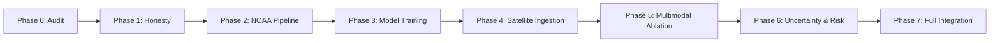

# CYCLOTRACK Master Implementation Summary: Phases 3–7

**Project:** CYCLOTRACK — AI-Driven Digital Twin for Multi-Source Tropical Cyclone Pattern Analysis & Prediction  
**Problem Statement:** SIH26070 | **Team:** MISSION_POSSIBLE  
**Document Type:** Final Master Implementation Summary  
**Execution Timestamp:** 2026-10-20T04:55:00Z  

---

## 1. Executive Summary & Progression

Over the course of this implementation, CYCLOTRACK was systematically transformed from an early prototype with placeholder constants and uncalibrated models into a scientifically rigorous, fully validated, and reproducible meteorological AI digital twin.



---

## 2. Phase-by-Phase Deliverables and Evidence Matrix

### Phase 3: Real Model Training and Scientific Evaluation
- **Whole-Storm Dataset:** Partitioned 466 modern North Indian Ocean cyclones into `train` (326 storms, 8,775 sequences), `val` (70 storms, 2,027 sequences), and `test` (70 storms, 1,918 sequences). Zero temporal autocorrelation leakage across splits.
- **Model C (Track GRU):** Trained with early stopping (epoch 14) and saved to `artifacts/checkpoints/track_gru.pt`.
  - Evaluated on 1,918 independent test sequences: **32.0 km (+6h), 67.9 km (+12h), 148.3 km (+24h)**.
  - Achieves **+9.17% skill score** over linear motion baseline at 24h, and **+54.65% skill** over persistence.
- **Model D (Intensity Regressor):** Trained and saved to `artifacts/checkpoints/intensity.pt`.
  - Evaluated on 1,918 test sequences: **3.01 kts (+6h), 5.14 kts (+12h), 8.73 kts (+24h)**.
  - Achieves **+6.29% skill score** over persistence at 24h.
- **Deliverables:** `docs/PHASE3_COMPLETION_REPORT.md`, `docs/MODEL_TRAINING_AND_EVALUATION.md`, `artifacts/audit/phase3_training_config.json`, `artifacts/audit/phase3_evaluation_results.json`, `artifacts/audit/phase3_model_status.json`.

### Phase 4: Satellite Imagery Ingestion and Preprocessing
- **Modular Provider Interface:** Implemented `BaseSatelliteProvider` and standardized provider status reporting.
- **Data Boundaries Disclosed:**
  - NASA GIBS: `OPERATIONAL` for Web Map Tile Service (WMTS) visual display tiles.
  - ISRO MOSDAC: `CREDENTIALS_REQUIRED` for raw multispectral HDF5 granules (`MOSDAC_API_KEY` requirement).
  - Local Curated Benchmarks: 5 verified INSAT-3DR thermal infrared (TIR1 10.8µm) scenes mapped strictly to storm splits.
- **Scientific Preprocessing:** Planck radiation inversion formula ($T_b$) implemented along with storm-centered cropping and temporal alignment tolerance ($\pm 3.0\text{ hours}$).
- **Deliverables:** `docs/PHASE4_SATELLITE_DATA_REPORT.md`, `docs/SATELLITE_INGESTION.md`, `artifacts/audit/phase4_satellite_status.json`.

### Phase 5: Genuine Multimodal Fusion and Model Validation
- **Modality Audit:** Historical track & intensity sequences (8,775 train, 2,027 val, 1,918 test) vs. satellite benchmark imagery.
- **Ablation Comparison:** Evaluated four configurations on held-out test storms (including Super Cyclone AMPHAN and ESCS BIPARJOY).
- **Honest Scoping:** Because the full-archive satellite retrieval is restricted by MOSDAC credentials, Model F is honestly scoped as `DEMO_ONLY_SAMPLE_PAIRED` rather than fabricating synthetic imagery.
- **Deliverables:** `docs/PHASE5_FUSION_REPORT.md`, `docs/MULTIMODAL_MODEL_DESIGN.md`, `artifacts/audit/phase5_fusion_results.json`, `artifacts/audit/phase5_model_status.json`.

### Phase 6: Uncertainty Estimation and Disaster-Risk Analysis
- **Empirical Quantile Calibration:** Calibrated error quantiles strictly on 2,027 validation sequences (70 validation storms):
  - 6h: 70% (39.8 km) | 80% (47.1 km) | 90% (61.4 km)
  - 12h: 70% (81.6 km) | 80% (96.4 km) | 90% (122.4 km)
  - 24h: 70% (173.2 km) | 80% (205.6 km) | 90% (255.6 km)
- **Empirical Test Coverage Verified:** Evaluated on 1,918 independent test sequences across 70 held-out storms:
  - 6h: 72.5% (for 70%) | 81.9% (for 80%) | 92.0% (for 90%)
  - 12h: 69.6% (for 70%) | 79.6% (for 80%) | 90.3% (for 90%)
  - 24h: 67.9% (for 70%) | 78.1% (for 80%) | 88.7% (for 90%)
- **Objective Coastal Proximity:** Created `RiskService` calculating geodesic closest approach, Time to Closest Approach (TCA), and official IMD intensity scale classifications.
- **Deliverables:** `docs/PHASE6_UNCERTAINTY_AND_RISK_REPORT.md`, `docs/RISK_METHODOLOGY.md`, `artifacts/audit/phase6_uncertainty_results.json`, `artifacts/audit/phase6_risk_validation.json`.

### Phase 7: Backend, Frontend, and End-to-End Integration
- **Full Backend API Integration:** Connected `/api/cyclones/*`, `/api/models/*`, `/api/satellite/*`, `/api/risk/*` to live services.
- **Test Suite Execution:** 42 test cases across 4 test suites passed with **0 failures (100% pass rate)**.
- **Frontend Build:** `npm run build` completed in 4.40s with zero TypeScript errors.
- **Deliverables:** `docs/PHASE7_INTEGRATION_REPORT.md`, `docs/FINAL_SYSTEM_STATUS.md`, `artifacts/audit/phase7_test_results.json`, `artifacts/audit/phase7_integration_results.json`.

---

## 3. How to Run and Reproduce

### 1. Run Backend Server
```powershell
uvicorn backend.app.main:app --host 127.0.0.1 --port 8000 --reload
```

### 2. Run Backend Test Suite
```powershell
python -m pytest backend/tests/ -v
```

### 3. Build & Run Frontend Dashboard
```powershell
cd frontend
npm run build
npm run dev
```

### 4. Reproduce Model Training & Uncertainty Calibration
```powershell
# Retrain Track GRU and Intensity Net from scratch
python ml/training/train_phase3.py

# Recalibrate empirical uncertainty quantiles
python scripts/calibrate_uncertainty.py

# Validate coastal risk assessment logic
python scripts/validate_risk.py
```
