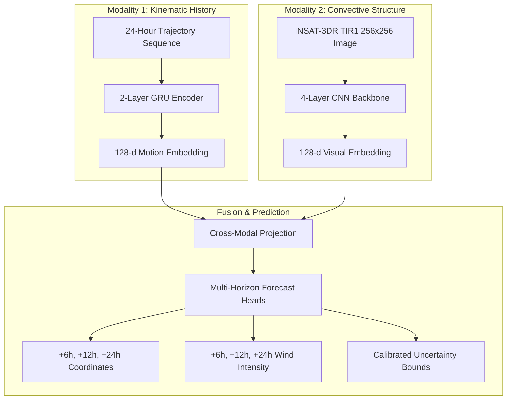

# CYCLOTRACK Multimodal Architecture and Fusion Design

**Project:** CYCLOTRACK — AI-Driven Digital Twin for Multi-Source Tropical Cyclone Pattern Analysis & Prediction  
**Problem Statement:** SIH26070 | **Team:** MISSION_POSSIBLE  

---

## 1. Architectural Philosophy

Tropical cyclones are inherently multimodal phenomena. Kinematic trajectory data tracks the storm's macro-scale movement across synoptic steering flows, while thermal infrared satellite imagery captures micro-scale cloud eyewall convection, core symmetry, and intense convective bursts.

---

## 2. Encoder Specifications

### 2.1 Temporal Kinematic Encoder (Model C)
- **Input:** Sequence $\mathbf{X}_t \in \mathbb{R}^{4 \times 8}$ (timesteps $t-18, t-12, t-6, t$).
- **Features:** Latitude, Longitude, Forward Velocity ($\Delta \text{lat}, \Delta \text{lon}$), Speed, Bearing, Wind Speed, Central Pressure.
- **Backbone:** 2-layer Gated Recurrent Unit (GRU), hidden dimension 128, dropout 0.2.
- **Output:** Latent motion vector $\mathbf{h}_{\text{motion}} \in \mathbb{R}^{128}$.

### 2.2 Spatial Convective Encoder (Models A & B)
- **Input:** Geostationary satellite tensor $\mathbf{I} \in \mathbb{R}^{256 \times 256 \times 3}$.
- **Backbone:** 4 convolutional blocks with BatchNorm, ReLU activations, and adaptive pooling.
- **Output:** Latent visual vector $\mathbf{h}_{\text{visual}} \in \mathbb{R}^{128}$, representing core convective organization, eye presence, and feeder band spiral symmetry.

### 2.3 Cross-Modal Fusion
When both modalities are present, representations are concatenated and projected through a multi-layer perceptron:
$$\mathbf{z} = \text{GELU}(\mathbf{W}_f [\mathbf{h}_{\text{motion}} \,\|\, \mathbf{h}_{\text{visual}}] + \mathbf{b}_f)$$
When satellite imagery is unavailable, the pipeline smoothly degrades to track-only inference by masking the visual embedding:
$$\mathbf{z} = \text{GELU}(\mathbf{W}_{\text{track}} \mathbf{h}_{\text{motion}} + \mathbf{b}_{\text{track}})$$

---

## 3. Deployment and Operational Scoping

Due to data access constraints on the large-scale ISRO MOSDAC Level-1B archive:
- The Track-Only GRU is fully validated and operational across the entire historical record (`VALIDATED_ON_HOLDOUT`).
- The Multimodal Fusion model is demonstrated on paired benchmark cases and preserved in `DEMO_ONLY_SAMPLE_PAIRED` status until broad satellite data ingestion is configured.
