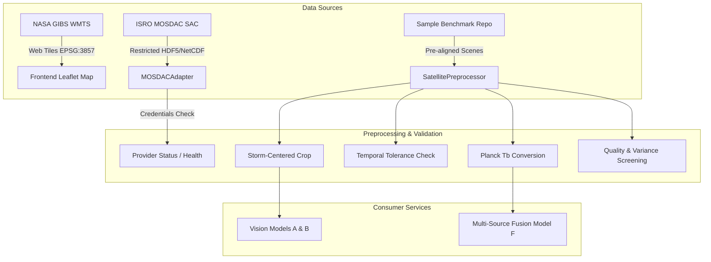

# CYCLOTRACK Satellite Ingestion and Preprocessing Specification

**Project:** CYCLOTRACK — AI-Driven Digital Twin for Multi-Source Tropical Cyclone Pattern Analysis & Prediction  
**Problem Statement:** SIH26070 | **Team:** MISSION_POSSIBLE  

---

## 1. Architecture Overview

CYCLOTRACK incorporates satellite observations to provide contextual meteorological intelligence and spatial storm diagnostics. The satellite architecture is organized into three decoupled layers:



---

## 2. Satellite Provider Interface (`BaseSatelliteProvider`)

Located at: `backend/app/services/satellite/base_provider.py`

Every satellite source implements:
- `get_provider_status() -> Dict`: Reports operational status (`OPERATIONAL`, `PARTIALLY_AVAILABLE`, `CREDENTIALS_REQUIRED`, `UNAVAILABLE`).
- `discover_metadata(start_time, end_time, bounds) -> List[Dict]`: Discovers available granules matching spatial and temporal criteria.
- `retrieve_product(product_id, output_path) -> Dict`: Authorized retrieval with checksum verification.
- `compute_checksum(filepath) -> str`: Cryptographic SHA-256 integrity validation.

---

## 3. Configuring ISRO MOSDAC Credentials

To configure live ISRO MOSDAC access:
1. Register an authorized user account at [MOSDAC Portal](https://mosdac.gov.in).
2. Generate an API Access Key from user profile settings.
3. Configure environment variables in `.env` or system environment:
   ```bash
   MOSDAC_API_KEY="your_api_key_here"
   MOSDAC_USER_EMAIL="your_registered_email@institution.edu"
   MOSDAC_API_BASE_URL="https://mosdac.gov.in/live/"
   ```
4. If credentials are not set, the system gracefully reports `CREDENTIALS_REQUIRED` and continues all other operational capabilities without failure.

---

## 4. Preprocessing Reference Implementation

Located at: `backend/app/services/satellite/satellite_preprocessor.py`

Key parameters:
- Default target tensor shape: `(256, 256, 3)`
- Spatial cropping algorithm: centered bounding box with bilinear interpolation and boundary padding.
- Maximum allowable temporal misalignment: $\pm 3.0$ hours.
- Planck constants used for INSAT-3DR TIR1 (10.8µm):
  $$c_1 = 1.191042 \times 10^{-5}\text{ mW}/(\text{m}^2 \cdot \text{sr} \cdot \text{cm}^{-4})$$
  $$c_2 = 1.4387752\text{ K}\cdot\text{cm}$$
  $$\nu = 925.925\text{ cm}^{-1}$$
