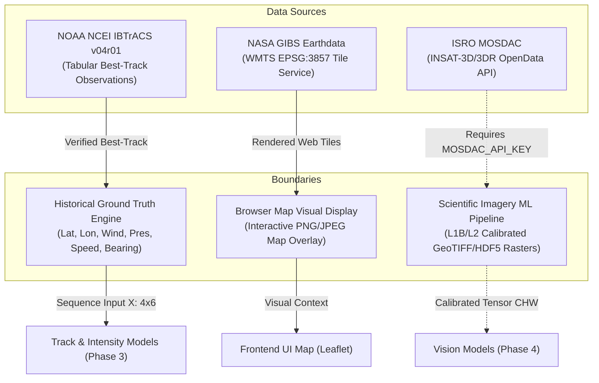

# CYCLOTRACK — Data Pipeline & Dataset Architecture

**Project:** CYCLOTRACK — AI-Driven Digital Twin for Multi-Source Tropical Cyclone Pattern Analysis & Prediction  
**Problem Statement:** SIH26070 | **Team:** MISSION_POSSIBLE  
**Pipeline Status:** Phase 2 Operational & Validated (NOAA IBTrACS v04r01)

---

## 1. Directory Structure

```
ml/data/
├── raw/
│   └── ibtracs/
│       └── ibtracs.NI.list.v04r01.csv       # Official NOAA NCEI raw archive (27.8 MB, gitignored)
├── processed/
│   └── ibtracs/
│       ├── ibtracs_ni_clean.csv             # Full parsed & normalized archive (1842-2026, 62,864 rows)
│       └── ibtracs_ni_modern.csv            # Satellite era (1980-2026, 466 storms, >=4 obs, 18,177 rows)
├── manifests/
│   ├── train_storms.json                    # Deterministic training split (326 storms, 12,661 obs)
│   ├── val_storms.json                      # Deterministic validation split (70 storms, 2,821 obs; inc. DANA)
│   └── test_storms.json                     # Deterministic test split (70 storms, 2,695 obs; inc. AMPHAN & BIPARJOY)
├── historical/
│   └── ibtracs_north_indian_ocean.csv       # Legacy 6-storm sample (preserved for backward compatibility)
└── sample_imagery/
    ├── manifest.json                        # 6 benchmark satellite imagery fixtures
    └── *.png                                # Curated benchmark visual/IR tiles
```

---

## 2. Official NOAA IBTrACS NI Dataset

### Source Provenance
- **Source Authority:** NOAA / NCEI International Best Track Archive for Climate Stewardship (IBTrACS)
- **Version:** `v04r01`
- **Basin Subset:** North Indian Ocean (`NI`)
- **Official Download URL:** [https://www.ncei.noaa.gov/data/international-best-track-archive-for-climate-stewardship-ibtracs/v04r01/access/csv/ibtracs.NI.list.v04r01.csv](https://www.ncei.noaa.gov/data/international-best-track-archive-for-climate-stewardship-ibtracs/v04r01/access/csv/ibtracs.NI.list.v04r01.csv)
- **Retrieval Timestamp:** `2026-10-19T18:02:57Z`
- **File Size:** `27,886,424 bytes` (26.6 MB)
- **SHA-256 Checksum:** `b30984b56c428391eff17a44d1a9662e444fc4ba419417e9613c18db07424155`

### Verified Data Quality Counts
| Metric | Count / Value | Verification Status |
| :--- | :--- | :--- |
| **Total Raw Rows** | 62,864 | VERIFIED |
| **Header Row** | Row 0 (174 columns) | VERIFIED |
| **Units Row** | Row 1 (`Year`, `kts`, `mb`, etc.) | VERIFIED (Skipped during numeric parsing) |
| **Unique Cyclone SIDs** | 1,859 storms | VERIFIED |
| **Date Coverage** | 1842-10-25 to 2026-09-24 (184 years) | VERIFIED |
| **Valid Coordinates** | 62,864 / 62,864 (100.0%) | VERIFIED (0 coordinates outside [-90, 90] / [-180, 180]) |
| **Valid UTC Timestamps** | 62,864 / 62,864 (100.0%) | VERIFIED (0 timestamp parse failures) |
| **Duplicate Observations** | 0 duplicate timestamps per storm ID | VERIFIED |
| **Modern Era (>=1980)** | 18,177 rows across 466 storms | VERIFIED |
| **Consensus Wind Speed Coverage** | 93.0% valid in modern era (16,919 fixes) | VERIFIED (Priority: IMD New Delhi -> WMO -> USA JTWC) |

---

## 3. Deterministic Storm-Level Splitting

To eliminate **temporal data leakage** (where consecutive 3-hourly observations of the same storm appear in both training and test sets), splits are strictly partitioned by **whole cyclone ID (`SID`)**:

$$\text{Train} \cap \text{Val} = \emptyset, \quad \text{Train} \cap \text{Test} = \emptyset, \quad \text{Val} \cap \text{Test} = \emptyset$$

### Split Summary (Algorithm: `DETERMINISTIC_WHOLE_STORM_SPLIT`, Seed: `42`)
- **Training Set (`train_storms.json`):** 326 cyclones (12,661 track observations, 69.95%)
- **Validation Set (`val_storms.json`):** 70 cyclones (2,821 track observations, 15.02%)
  - *Preserved Holdouts:* Cyclone DANA (2024, `2024295N15092`), REMAL (2024), MICHAUNG (2023)
- **Test Set (`test_storms.json`):** 70 cyclones (2,695 track observations, 15.02%)
  - *Mandatory Holdouts Preserved:* Super Cyclone AMPHAN (2020, `2020136N10088`), Extremely Severe Cyclonic Storm BIPARJOY (2023, `2023156N10067`)
- **Disjointness Proof:** Automated unit test `test_manifest_storm_level_isolation` verifies 0 storm overlap across splits.

---

## 4. Satellite-Data Boundaries & System Architecture

A core scientific principle of CYCLOTRACK is maintaining strict boundaries between different data modalities and visualization layers:



### Boundary Definitions

#### A. NOAA IBTrACS (Archival Best-Track Data)
- **Nature:** Best-track post-season meteorological consensus fixes.
- **Fields:** Position (latitude, longitude), intensity (central pressure, sustained wind speed), forward motion (translation speed, bearing azimuth), landfall flags, and distance to land.
- **Role:** Ground truth target and sequential trajectory feature source for track and intensity forecasting.
- **Bound:** **IBTrACS is NOT satellite imagery.** It contains no pixel data, sensor radiance, or cloud reflectance.

#### B. NASA GIBS (Map Visualization Layer)
- **Nature:** Open, public WMTS tile service providing pre-rendered RGB images (EPSG:3857 Web Mercator) from VIIRS (SNPP/NOAA-20), MODIS (Terra/Aqua), and geostationary composites.
- **Role:** Real-time and historical interactive map background displayed in the Leaflet browser dashboard.
- **Bound:** **Rendered GIBS browser tiles are NOT scientific ML training tensors.** They are compressed, 8-bit visual representations lacking physical radiometer calibrations, multiple raw spectral bands, and calibrated brightness temperatures.

#### C. Machine-Readable Satellite Imagery Pipeline (Requirements for Phase 4)
For genuine deep learning satellite models (CNN/ViT detection and classification), the required ingestion pipeline entails:
1. **Source Product:** Level-1B (calibrated radiances) or Level-2 (derived geophysical parameters) from INSAT-3D/3DR (IMAGER / SOUNDER) or Himawari-8/9 (AHI).
2. **Spectral Bands:** Thermal Infrared (TIR-1: 10.8 µm), Water Vapor (WV: 6.8 µm), Mid-Infrared (MIR: 3.9 µm), and Visible (VIS: 0.65 µm).
3. **Format:** Scientific raster formats (HDF5 / NetCDF-4) preserving 16-bit floating-point radiance / brightness temperature ($T_b$) values.
4. **Spatial Processing:** Reprojection to equidistant projection, storm-centered cropping ($10^\circ \times 10^\circ$ bounding box centered on IBTrACS eye fix), and limb-darkening correction.
5. **Quality Control:** Removal of calibration striping, scan anomalies, and solar contamination in 3.9 µm channel.

#### D. ISRO MOSDAC Integration (Indian Space Research Organisation)
- **Nature:** Official repository for INSAT-3D, INSAT-3DR, and OceanSat meteorological products covering the North Indian Ocean basin.
- **Adapter Implementation:** `backend/app/services/satellite/mosdac_adapter.py`.
- **Credential Requirement:** Requires valid user registration and API authentication credentials (`MOSDAC_API_KEY` and `MOSDAC_USER_EMAIL`).
- **Current Operational Status:** `CREDENTIALS_REQUIRED` / `UNAVAILABLE`.
- **Security Rule:** No secrets or credentials are hardcoded or committed to git. In the absence of environment credentials, the system truthfully reports `UNAVAILABLE` without crashing or inventing synthetic observations.

---

## 5. Pipeline Reproduction Commands

To download the raw archive, validate data quality, and generate reproducible splits:

```powershell
# 1. Download official NOAA IBTrACS NI archive
python scripts/download_official_ibtracs.py

# 2. Parse, clean, validate, and generate deterministic storm manifests
python scripts/process_ibtracs.py

# 3. Execute automated test suite
python -m pytest backend/tests/test_data_pipeline.py -v
python -m pytest backend/tests/ -v
```
